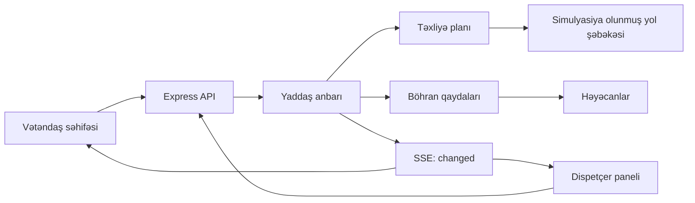

# Texniki izah

Urban Crisis & Crowd Evacuation Engine-in qaydaları və HTTP API bir Node prosesindədir. Lokal `npm start` həmin prosesdən həm API-ni, həm də `frontend/` səhifələrini verir. Docker-də isə API və nginx ilə verilən frontend ayrı servisdir; nginx `/api` yolunu API-yə ötürür. Vəziyyət yaddaşdadır və server yenidən işə düşəndə ilkin Bakı nümunəsinə qayıdır.

## Modullar

| Qat | Fayl | Məsuliyyət |
| --- | --- | --- |
| Siyasət | `server/config.js` | 5 dəqiqə, 4 SOS, 500 m, 90%, 95%, Bakı çərçivəsi |
| Şəhər məlumatı | `server/data/city.js` | Rayonlar, məntəqələr, yollar, briqadalar |
| Marşrut | `server/domain/routing.js` | Dijkstra. Bağlı seqment açıq marşrutdan çıxarılır |
| Təxliyə | `server/domain/evacuation.js` | Məntəqə seçimi və alternativ marşrutun mətni |
| Böhran | `server/domain/crisis.js` | Zona klasteri, 500 m klasteri, doluluq həyəcanı |
| Vəziyyət | `server/store.js` | SOS, təsdiq, müvəqqəti məntəqə, briqada |
| Xarici marşrut | `server/providers/routing.js` | OSRM, 5 saniyə limiti, circuit breaker, lokal matris |
| HTTP | `server/app.js` | API, statik səhifələr, SSE |

Veb səhifələr `frontend/` altındadır və qurulma addımı tələb etmir. Brauzer həmişə nisbi `/api` ünvanından istifadə edir, ona görə eyni səhifə həm Express, həm də nginx arxasında işləyir. Dil `Accept-Language` başlığı və ya `lang` sahəsi ilə seçilir: `az` və ya `en`. Saxlanan həyəcan mətni Azərbaycan dilində qalır; ingilis mətni oxunuş zamanı yaranır. Xəritə Leaflet və OpenStreetMap kirəmitləridir. Kirəmitlər yalnız şəkil üçündür; qərar lokal yol şəbəkəsinə əsaslanır. Dispetçer xəritəsində eyni kirəmitlər tünd fonda göstərilir. Mobil ölçüdə vətəndaş səhifəsində xəritə yuxarıda, SOS düymələri aşağıda yapışıq qalır. Dispetçer panelində Xəritə, SOS və Resurslar bölmələri ayrıca açılır.

## Vətəndaş axını

Mövqe ya seçilmiş rayonun mərkəzidir, ya da koordinatdır. Koordinat ən yaxın rayon mərkəzinə görə rayona bağlanır. Bu, rəsmi poliqon deyil.

Planlayıcı hər açıq məntəqə üçün iki ən qısa yol hesablayır: bağlanan seqmentlərlə və onlarsız. Sonra:

1. Doluluğu 90% və ya daha yüksək olan məntəqə tövsiyə olunmur.
2. Açıq yolu olmayan məntəqə tövsiyə olunmur.
3. Qalanlar içindən səyahət müddəti ən kiçik olan seçilir.
4. Əgər daha yaxın məntəqə doluluq ucbatından kənarda qalıbsa, yol bağlı olduğu üçün qısa marşrut dəyişibsə, cavabda `notice` və `route.alternative: true` olur.

Cavab həm tövsiyəni, həm növbəti variantları, həm də kənarda qalan məntəqənin səbəbini qaytarır. Bağlı seqmentlər xəritədə qırmızı göstərilir.

Hərəkət məhdudiyyəti rolu vətəndaş səhifəsində seçilir. Bu rolla göndərilən SOS avtomatik `KLİNİK PRİORİTET` və prioritet `1` statusu alır. Planlayıcı həmin sorğuda pilləkənli məntəqələri və əlil arabası ilə tibbi nəqliyyatın keçmədiyi seqmentləri kənara qoyur; qalan marşrut panduslu və ya maneəsiz girişə aparır. Rayonda belə giriş yoxdursa, rayon mərkəzində panduslu müvəqqəti sığınacaq açılır. Yasamal bu haldadır: insan Tofiq Bəhramov və ya Nərimanovadək getmir.

SOS növləri: `fire`, `collapse`, `flood`, `medical`. Eyni sessiya eyni növü 30 saniyə içində təkrarlasa, ikinci yazı yaradılmır. “Təhlükəsizdəyəm” həmin sessiyanın aktiv siqnallarını `safe` edir. Təhlükəsiz və ya check-in yazıları 4 SOS hesabına daxil deyil.

## Dispetçer və böhran qaydası

Hər dəyişiklikdən sonra `crisisRules` siyahısı işləyir. Yeni qayda bu massivə funksiya əlavə etməklə qoşulur; imza `ctx -> draft[]`-dır.

İki hazır şərt var. Biri ödənəndə həyəcanın mətni həmişə budur:

> Əlavə xilasetmə briqadası göndər və yeni toplanış nöqtəsi aç

Şərtlər:

- Son 5 dəqiqədə eyni rayonda ən azı 4 fərqli aktiv SOS. “Fərqli” ayrı-ayrı siqnal yazısı deməkdir.
- Eyni 4 siqnal bir rayonun içində deyilsə, amma hansısa nöqtədən 500 metr radiusa düşürsə, radius həyəcanı yaranır.
- Toplanış məntəqəsinin göstərilən doluluğu 95%-i **keçəndə**. 95.0 həyəcan açmır, 96 açır.

Zona həyəcanı siqnallar sonradan “Təhlükəsizdəyəm” olsa da, operator təsdiqləyənə qədər açıq qalır. Eyni sübut dəsti təsdiqdən sonra ikinci dəfə həyəcan açmır. Pəncərədə ən azı 4 yeni siqnal gələrsə, yeni həyəcan açıla bilər.

Doluluq 95 və ya altına düşəndə açıq doluluq həyəcanı səngiyir və qayda yenidən silahlanır. Təsdiqdən sonra doluluq yüksək qalsa, eyni məntəqə üçün ikinci həyəcan açılmır; doluluq əvvəl 95-ə düşüb sonra yenidən keçəndə açılır.

“Qərarı icra et” iki iş görür:

1. Hədəfə ən yaxın **hazır** briqadanı göndərir. Hazır briqada yoxdursa, ehtiyat briqada yaradır.
2. Həyəcan nöqtəsinin yanında müvəqqəti məntəqə açır və onu ən yaxın yol qovşağına “Müvəqqəti keçid” ilə bağlayır. Vətəndaş planı bu məntəqəni növbəti sorğuda görür.

Panel hər dəyişiklikdə `changed` SSE hadisəsi alır və vəziyyəti yenidən oxuyur. SSE kəsilərsə, səhifə 8 saniyədən bir yenə soruşur.

## Əsas API

| Metod | Ünvan | Məna |
| --- | --- | --- |
| GET | `/api/health` | Proses ayıqdır |
| GET | `/api/citizen/zones` | Rayonlar və hədlər |
| POST | `/api/citizen/plan` | `{ zoneId }` və ya `{ lat, lng }` |
| POST | `/api/citizen/sos` | `{ type, sessionId, zoneId \| lat, lng }` |
| POST | `/api/citizen/safe` | Sessiyanın statusunu təhlükəsiz edir |
| GET | `/api/citizen/status?sessionId=` | Sessiya statusu |
| GET | `/api/traffic` | Simulyasiya olunmuş yol-nəqliyyat endpoint-i |
| GET | `/api/operator/state` | Panelin tam şəkli |
| POST | `/api/auth/login` | Dispetçer JWT-si (`role: dispatcher`) |
| POST | `/api/operator/alerts/:id/confirm` | Qərarı icra edir. Yalnız dispetçer rolu |
| POST | `/api/operator/roads/:id/toggle` | Seqmenti bağlayır və ya açır. Yalnız dispetçer rolu |
| POST | `/api/operator/shelters/:id/occupancy` | `{ percent }`. Yalnız dispetçer rolu |
| POST | `/api/operator/demo/signal` | Seçilmiş rayona bir SOS. Yalnız dispetçer rolu |
| POST | `/api/operator/demo/cluster` | Eyni rayona dörd SOS. Yalnız dispetçer rolu |
| GET | `/api/events` | `text/event-stream` |

## Genişlənmə

Növbəti tapşırıqlar üçün dəyişiklik yeri əvvəlcədən ayrılıb:

- SOS seli qəbuldan əvvəl kəsilir. Eyni ünvandan dəqiqədə 8, eyni sessiyadan 4, bütün sistemdə isə 10 saniyədə 30 yeni müraciət keçir. Artığı `429` qaytarır və anbara, panelə, canlı yayına düşmür. Eyni sessiya və eyni təhlükə 30 saniyə ərzində ikinci sətir açmır.
- Briqada göndərişi, yolun bağlanması və doluluq dəyişikliyi `Authorization: Bearer` və `role: dispatcher` tələb edir. Tokensuz sorğu `401`, başqa rol `403` alır. Lokal giriş `dispatcher` / `baki-dispetcer` dir; açıq serverdə `JWT_SECRET`, `DISPATCHER_USER` və `DISPATCHER_PASSWORD` dəyişilməlidir.
- Hədlər və SOS növləri `server/config.js`-dədir.
- Yeni həyəcan şərti `server/domain/crisis.js` içindəki `crisisRules` massivinə əlavə olunur.
- Yeni şəhər və ya məntəqə `server/data/city.js` verilənlərinə əlavə olunur; planlayıcı və həyəcan kodu rayon sayından asılı deyil.
- Yol mənbəyi `ROUTING_PROVIDER` ilə seçilir. Küçə xidmətinin limiti `ROUTING_TIMEOUT_MS` (susma 5000) dəyərindədir. 503, fasilə və şəbəkə xətası dövrəni açır; məsafə son keşdən və ya `localNetwork` matrisindən qalır.
- `createStore` anbarın sərhədidir. PostgreSQL və ya Redis adaptoru eyni metodları (`plan`, `addSos`, `confirmAlert`, `operatorState`) saxlasa, HTTP qatı dəyişmir.
- Real vaxt `server/hub.js` üzərindən bir hadisədir. Veb-soket və ya növbə eyni `changed` hadisəsini yaya bilər.
- Veb səhifələr API-dən ayrıdır. Mobil müştəri eyni endpoint-lərdən istifadə edə bilər.

## Məhdudiyyətlər

- Yol şəbəkəsi Bakının əsas istiqamətlərini təmsil edən kiçik qrafdır, tam küçə reyestrı deyil.
- Məntəqə tutumları və ilkin doluluq ssenari üçündür.
- Rayon sərhədi ən yaxın mərkəzdir.
- Operator API-si autentifikasiyasızdır. Xaricə açılmazdan əvvəl sessiya, rol və sürət limiti lazımdır.
- Vəziyyət proses yaddaşındadır.
- Xəritədəki marşrut xətti seçilmiş qraf nöqtələrindən keçən küçə trayektoriyasıdır. Bağlı seqment qərarı əvvəlcə qrafda verilir, ona görə xətt həmin bağlı seqmentdən keçmir. Küçə xidməti 503 qaytaranda, 5 saniyədən çox susanda və ya şəbəkə kəsiləndə sorğu istisna atmadan kəsilir. Circuit breaker açılır və məsafə son keşdən, yoxdursa statik koordinat matrisindən hesablanır. Vətəndaş «Oflayn/Ehtiyat marşrut rejimində işləyir» bildirişini görür.
- Prototip real xilasetmə qərarı üçün istifadə olunmamalıdır.
